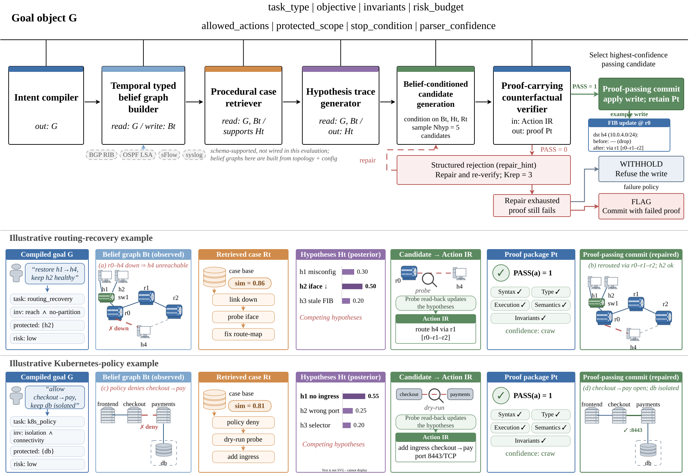

<h1 align="center">
  VISTA: Verified Belief-Centric LLM Agents<br>
  for Safe Network Management
</h1>
<p align="center">
  <a href="#"></a>
  <a href="./CODE_EXPLANATION.md"></a>
  <a href="./LICENSE"></a>
  <a href="mailto:25120143@bjtu.edu.cn"></a>
</p>
<p align="center">
  <a href="#">Yakai Dai</a>,
  <a href="#">Jia Chen</a><sup>*</sup>,
  <a href="#">Xu Huang</a>,
  <a href="#">Rui Dong</a>,
  <a href="#">Tao Fu</a>
</p>

<p align="center">
  <sup>*</sup> Corresponding author
</p>

---


## Abstract
Large language model (LLM) agents now commit changes in production network management, where one change can touch routing-protocol state or a Kubernetes NetworkPolicy. The prevailing pipeline emits the change as a single text answer, so the network state, the competing root-cause hypotheses, and the operational invariants travel through the same token stream as the answer---a design that is unsafe on the NetArena dynamic benchmark: on capacity planning, the strongest supervised and retrieval-augmented baselines reach near-perfect correctness while leaving $41\%$ of executed actions unsafe. VISTA gives each hidden quantity a persistent owner: it maintains a typed belief graph over topology and configuration, reasons over an explicit hypothesis trace, and routes every candidate write through a counterfactual verifier that emits a typed proof object, whose structured failure reasons re-enter the next round. On a shared Qwen2.5-Coder-7B backbone and NetArena's official scorer, no single prompting strategy is safe across capacity planning's ten query classes.  Under $\pi=WITHHOLD$ (proof failure blocks the write), VISTA reaches safety $1.000$ at commit $0.869$.  Under $\pi{=}FLAG$ (proof failure annotates but proceeds), it attains the per-class maximum on all ten classes, lifting safety from the $0.709$ per-class oracle envelope to $0.869$ at correctness $0.992$, commit $1.000$, and zero refusals, with a paired query-level margin of $153$--$0$. An ablation attributes the gain: the gate itself does not move the safety rate, which is set by feeding belief and hypothesis structure back into generation, while the gate contributes a commit-time certificate agreeing with the official scorer on $869/869$ admitted writes and a rejection whose structure decides repairability ($60/86$ versus $0/86$), at  ${\approx}13{\times}$ latency ($3.520$\,s).  On routing and Kubernetes the same workflow trades ${\approx}70\%$ refusal for high safety and is diagnostic, not deployable.



## Results


| Method | Correctness | Safety | Commit | Refuse |
| --- | ---: | ---: | ---: | ---: |
| Zero-shot | 0.580 | 0.464 | 1.000 | 0.000 |
| Zero-shot CoT | 0.418 | 0.418 | 1.000 | 0.000 |
| Few-shot | *0.800* | 0.554 | 1.000 | 0.000 |
| Semantic few-shot | **1.000** | 0.589 | 1.000 | 0.000 |
| SFT-only | **1.000** | 0.000 | 1.000 | 0.000 |
| No-op (decline all writes) | 0.000 | **1.000** | 0.000 | 1.000 |
| *Per-class envelope* (oracle) | — | 0.709 | — | — |
| *Per-query union* (oracle) | — | 0.716 | — | — |
| **VISTA (Flag)** | *0.992* | *0.869* | 1.000 | 0.000 |
| **VISTA (Flag, SFT)** | *0.993* | *0.868* | 1.000 | 0.000 |
| **VISTA (WITHHOLD)** | 0.861 | **1.000** | 0.869 | 0.131 |


## Citation

```bibtex
@article{dai2026vista,
  title={VISTA: Verified Belief-Centric LLM Agents for Safe Network Management},
  author={Dai, Yakai and Chen, Jia and Huang, Xu and Dong, Rui and Fu, Tao},
  journal={arXiv preprint},
  year={2026}
}
```
